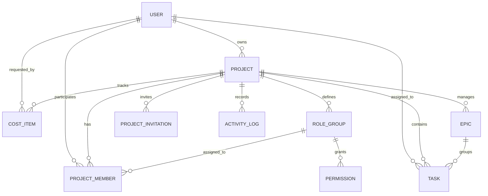

# 📘 TÀI LIỆU TOÀN DIỆN HỆ THỐNG QUẢN TRỊ DỰ ÁN AGILE/SCRUM & TÀI CHÍNH FTODO

---

## 📑 MỤC LỤC
1. [Tổng quan Dự án (Executive Summary)](#1-tổng-quan-dự-án-executive-summary)
2. [Kiến trúc Hệ thống & Ngăn xếp Công nghệ (Tech Stack)](#2-kiến-trúc-hệ-thống--ngăn-xếp-công-nghệ-tech-stack)
3. [Chi tiết Tính năng & Phân hệ Chức năng (Functional Modules)](#3-chi-tiết-tính-năng--phân-hệ-chức-năng-functional-modules)
   - [3.1. Bảng điều khiển Tổng thể (Global Dashboard)](#31-bảng-điều-khiển-tổng-thể-global-dashboard)
   - [3.2. Bảng Scrum Tương tác (Interactive Scrum Board)](#32-bảng-scrum-tương-tác-interactive-scrum-board)
   - [3.3. Cấu trúc Phân rã WBS & Product Backlog](#33-cấu-trúc-phân-rã-wbs--product-backlog)
   - [3.4. Lộ trình Dự án & Biểu đồ Gantt (Roadmap / Timeline)](#34-lộ-trình-dự-án--biểu-đồ-gantt-roadmap--timeline)
   - [3.5. Quản trị Tài chính Chiến lược & Chỉ số ROI / EVM](#35-quản-trị-tài-chính-chiến-lược--chỉ-số-roi--evm)
   - [3.6. Trung tâm Báo cáo & Trình duyệt Văn bản PDF](#36-trung-tâm-báo-cáo--trình-duyệt-văn-bản-pdf)
   - [3.7. Quản lý Nhân sự, Phân quyền Động RBAC & Lời mời Dự án](#37-quản-lý-nhân-sự-phân-quyền-động-rbac--lời-mời-dự-án)
   - [3.8. Phân hệ Kênh Chat & Tin nhắn Cá nhân Độc lập](#38-phân-hệ-kênh-chat--tin-nhắn-cá-nhân-độc-lập)
   - [3.9. Kiến trúc Điều hướng & Trải nghiệm Workspace](#39-kiến-trúc-điều-hướng--trải-nghiệm-workspace)
4. [Mô hình Cơ sở Dữ liệu & Thiết kế Thực thể (Database Schema)](#4-mô-hình-cơ-sở-dữ-liệu--thiết-kế-thực-thể-database-schema)
5. [Tài liệu API & Tích hợp Swagger (API Specifications)](#5-tài-liệu-api--tích-hợp-swagger-api-specifications)
6. [Tự động hóa CI/CD & Triển khai (DevOps)](#6-tự-động-hóa-cicd--triển-khai-devops)
7. [Kịch bản Mẫu Quay Video Giới thiệu Sản phẩm (Demo Walkthrough)](#7-kịch-bản-mẫu-quay-video-giới-thiệu-sản-phẩm-demo-walkthrough)

---

## 1. TỔNG QUAN DỰ ÁN (EXECUTIVE SUMMARY)

### 1.1. Bối cảnh & Vấn đề giải quyết
Trong quy trình phát triển phần mềm hiện đại, có một khoảng cách lớn giữa:
- **Đội ngũ kỹ thuật thực thi (Developers, QA, DevOps):** Quen thuộc với mô hình Agile/Scrum, User Stories, Story Points, Kanban/Scrum Board (như Jira, Linear, Trello).
- **Cấp quản lý chiến lược & Ra quyết định (Product Owner, Giám đốc dự án, CFO, Nhà đầu tư):** Quan tâm đến hiệu quả đầu tư, dòng tiền, chi phí phát sinh thực tế, tỷ suất hoàn vốn (**ROI**), chỉ số kiểm soát ngân sách (**EVM - CPI/SPI**) và tốc độ tiêu tiền (**Burn Rate/Runway**).

**FTodo** ra đời nhằm xóa bỏ hoàn toàn khoảng cách này. Đây là hệ thống **Quản trị Vòng đời Phát triển Phần mềm Toàn diện (All-in-One SDLC Management Platform)**, tích hợp mượt mà giữa:
1. **Thực thi Agile chuẩn mực:** Quản lý Backlog, lập kế hoạch Sprint, chia nhỏ công việc WBS, kéo thả Kanban, ước lượng Story Points, biểu đồ Burndown.
2. **Quản trị Tài chính Doanh nghiệp:** Luồng đề xuất giải ngân 2 chiều minh bạch, phân tích EVM (Earned Value Management), ROI Simulator, cảnh báo bội chi.
3. **Quản trị Nhân sự & Phân quyền Động (Dynamic RBAC):** Cấp quyền theo nhóm vai trò, cấp quyền riêng lẻ từng trang con, luồng gửi và chấp nhận lời mời dự án, nhật ký kiểm toán (Audit Trail Log).
4. **Không gian Trao đổi Thời gian thực (Chat Workspace):** Kênh thảo luận nhóm theo chủ đề và chat riêng 1-on-1 giữa các thành viên.

### 1.2. Đối tượng Người dùng Mục tiêu
| Nhóm người dùng | Mục đích sử dụng chính trên FTodo |
| :--- | :--- |
| **Product Owner (Chủ dự án / Sếp)** | Quản lý lộ trình Roadmap, duyệt đề xuất chi phí, phân tích ROI, phê duyệt báo cáo PDF, cấu hình phân quyền và gửi lời mời thành viên. |
| **Scrum Master** | Điều phối Sprint, theo dõi Burndown Chart, giám sát vận tốc Sprint (Velocity), đảm bảo tiến độ và gỡ bỏ trở ngại (Blockers). |
| **Lập trình viên (Developer)** | Quản lý tác vụ trên Bảng Scrum kéo thả, cập nhật trạng thái, tham gia Planning Poker ước lượng điểm, gửi đề xuất mua công cụ/server. |
| **Kiểm thử viên (QA/Tester)** | Quản lý Bug, User Story kiểm thử, xuất báo cáo nghiệm thu gửi Sếp phê duyệt. |

---

## 2. KIẾN TRÚC HỆ THỐNG & NGĂN XẾP CÔNG NGHỆ (TECH STACK)

```
                    ┌────────────────────────────────────────────────────────┐
                    │               CLIENT LAYER (Browser)                   │
                    │       Next.js 15 App Router + React 19 + Tailwind 4    │
                    └───────────┬────────────────────────────────┬───────────┘
                                │ HTTP / REST (JWT Bearer)       │ Realtime Sync
                                ▼                                ▼
                    ┌────────────────────────────┐ ┌─────────────────────────┐
                    │     BACKEND API SERVER     │ │    CLIENT BROADCAST     │
                    │      NestJS 11 + TS        │ │   LocalStorage Event    │
                    │ Swagger OpenAPI 3.0 (/docs)│ │  Cross-tab Reactive     │
                    └─────────────┬──────────────┘ └─────────────────────────┘
                                  │ Prisma ORM
                                  ▼
                    ┌────────────────────────────┐
                    │     DATABASE LAYER         │
                    │   PostgreSQL 16 (Docker)   │
                    └────────────────────────────┘
```

### 2.1. Frontend Stack
- **Framework:** **Next.js 15 (App Router)** với trình biên dịch thế hệ mới **Turbopack**. Tận dụng tối đa mô hình Hybrid: Server Components (SSR) và Client Components tương tác cao.
- **Thư viện UI Core:** **React 19** kết hợp **TypeScript 5.x** nghiêm ngặt.
- **Tạo kiểu (Styling):** **Tailwind CSS 4.0** với CSS Variables, hỗ trợ Dark Mode / Light Mode mượt mà.
- **Bộ Component chuẩn:** **Radix UI Primitives** kết hợp triết lý **Shadcn UI** (Dialog, DropdownMenu, Avatar, Badge, Progress, ScrollArea, Tooltip, Input, Button).
- **Trực quan hóa Dữ liệu (Charts):** **Recharts** vẽ biểu đồ Bar Chart tần suất hàng tuần, Burndown Chart tiến độ và đường cong ROI.
- **Tương tác Kéo thả:** Native HTML5 Drag and Drop API cho Bảng Scrum, tối ưu hiệu năng không phụ thuộc thư viện nặng.
- **Hệ thống Icon:** **Lucide React** đồng bộ toàn hệ thống.

### 2.2. Backend Stack
- **Framework:** **NestJS 11** kiến trúc module hóa hướng đối tượng (Controllers, Services, DTOs, Guards, Interceptors).
- **Tài liệu API:** **Swagger / OpenAPI 3.0** tích hợp tại `/api/docs`, hỗ trợ Bearer Token Authentication để thử nghiệm trực tiếp trên giao diện web.
- **Cơ sở Dữ liệu & ORM:** **PostgreSQL 16** quản lý qua **Prisma ORM** (Schema-first migration, type-safe queries, relational cascades).
- **Xác thực & Bảo mật:** **Passport.js**, **JWT (JSON Web Tokens)**, mã hóa mật khẩu bcrypt, `class-validator` và `class-transformer` kiểm định dữ liệu đầu vào nghiêm ngặt.

### 2.3. Môi trường Container & CI/CD
- **Containerization:** **Docker** và **Docker Compose** đóng gói PostgreSQL và các dịch vụ phụ trợ.
- **Tự động hóa CI/CD:** **GitHub Actions Workflow** tự động chạy kiểm thử Unit Test Jest, sinh Prisma Client, kiểm tra biên dịch TypeScript (`tsc --noEmit`) và build toàn bộ source code trên môi trường Ubuntu/Node.js 20.

---

## 3. CHI TIẾT TÍNH NĂNG & PHÂN HỆ CHỨC NĂNG (FUNCTIONAL MODULES)

### 3.1. Bảng điều khiển Tổng thể (Global Dashboard)
*Đường dẫn: `/`*

- **4 Chỉ số Hiệu suất Hệ thống (KPI Cards):**
  - **Tổng số dự án:** Phân rã số lượng dự án làm chủ (Owner) và dự án tham gia (Member).
  - **Dự án làm chủ (Owner):** Thể hiện số lượng dự án người dùng nắm quyền quản trị tối cao.
  - **Dự án tham gia (Member):** Thể hiện số lượng dự án người dùng làm việc theo vai trò được cấp quyền.
  - **Tỷ lệ Hoàn thành Công việc:** Tính toán tổng số công việc đã giải quyết trên toàn bộ các dự án (`completedTasks / totalTasks`).
- **Biểu đồ Tần suất Công việc Hàng tuần (Weekly Velocity Chart):** Biểu đồ cột hiển thị trực quan số lượng công việc được hoàn thành từ Thứ Hai đến Chủ Nhật.
- **Danh sách Dự án & Bộ lọc Linh hoạt:**
  - Bộ tìm kiếm tức thời theo tên và mô tả dự án.
  - Thanh lọc phân loại 3 chế độ: *Tất cả*, *Làm chủ*, *Tham gia*.
  - Thẻ dự án hiển thị tiến độ (Progress bar), số thành viên, số lượng tác vụ và nút truy cập nhanh vào Không gian làm việc.
- **Thanh bên phải (Right Sidebar):**
  - **Thẻ Lời mời Dự án Nhỏ gọn:** Thông báo các lời mời người dùng nhận được từ các Chủ dự án khác, hiển thị tên dự án, người mời, vai trò chỉ định, nút **Chấp nhận** (tự động thêm vào danh sách dự án) hoặc **Từ chối**.
  - **Thẻ Lịch sử Hoạt động (Audit Log):** Hiển thị các hành động hệ thống gần nhất (ai xóa task, ai duyệt ngân sách, ai cập nhật trạng thái).
- **Khởi tạo Dự án Mới:** Modal tạo dự án nhanh, tự động thiết lập hệ thống nhóm quyền và kênh trao đổi mặc định.

---

### 3.2. Bảng Scrum Tương tác (Interactive Scrum Board)
*Đường dẫn: `/projects/[id]/board`*

- **4 Cột Trạng thái Chuẩn Agile:** `To Do` (Cần làm) ➔ `In Progress` (Đang làm) ➔ `Review` (Kiểm thử) ➔ `Done` (Hoàn thành).
- **Kéo thả Thẻ việc Mượt mà:** Cho phép kéo thả trực quan giữa các cột, tự động cập nhật tiến độ phần trăm của Sprint.
- **Bộ lọc "Việc của tôi" (Only My Tasks):** Chuyển đổi 1-chạm giúp thành viên tập trung cao độ vào những công việc mình phụ trách mà không bị phân tâm bởi công việc của người khác.
- **Theo dõi Mục tiêu Sprint & Story Points:** Thanh thông tin tổng hợp hiển thị mục tiêu Sprint (Sprint Goal), tỷ lệ hoàn thành điểm (`Done Points / Total Points`) và số lượng thẻ task.
- **Thông tin Thẻ Task Toàn diện:**
  - Nhãn phân loại trực quan: 📘 **User Story**, 📋 **Task kỹ thuật**, 🐞 **Bug lỗi**.
  - Huy hiệu điểm ước lượng Fibonacci: `1, 2, 3, 5, 8, 13 SP`.
  - Nhãn Epic cha liên kết.
  - Avatar người phụ trách và ngày hết hạn.

---

### 3.3. Cấu trúc Phân rã WBS & Product Backlog
*Đường dẫn: `/projects/[id]/backlog`*

- **Cấu trúc Phân rã Công việc (Work Breakdown Structure - WBS):**
  - Phân cấp 3 tầng chuẩn quản trị dự án: **Cấp 1: Epic Chiến lược** ➔ **Cấp 2: User Stories** ➔ **Cấp 3: Tác vụ Kỹ thuật Thực thi**.
  - Bộ lọc theo từng Epic hiển thị tổng số điểm Story Points tích lũy của riêng Epic đó.
- **Ngăn chứa Kế hoạch Sprint (Sprint Planning Containers):**
  - **Active Sprint 1:** Khu vực chứa các công việc cam kết thực hiện trong Sprint hiện tại kèm ngày bắt đầu và ngày kết thúc.
  - **Product Backlog:** Kho chứa tất cả các ý tưởng, tính năng tương lai chưa đưa vào chu kỳ phát triển.
- **Điều chuyển Công việc Nhanh:** Nút **"Vào Sprint 1 ↑"** hoặc chuyển xuống Backlog chỉ bằng một cú nhấp chuột, tự động tính toán lại dung lượng tải của Sprint.
- **Điều chỉnh Điểm Story Points Tức thì:** Cho phép thay đổi ước lượng độ phức tạp trực tiếp trên từng dòng công việc.

---

### 3.4. Lộ trình Dự án & Biểu đồ Gantt (Roadmap / Timeline)
*Đường dẫn: `/projects/[id]/timeline`*

- **Trục Thời gian Chi tiết:** Hiển thị trực quan theo từng ngày, từng tuần và từng tháng (tháng 10 và tháng 11/2026).
- **Cột mốc Thời gian Thực:** Đường chỉ dẫn màu đỏ đánh dấu chính xác ngày *"Hôm nay"*, giúp nhận biết hạng mục nào đang đúng hạn hay trễ hạn.
- **Thanh Gantt Tỷ lệ Thực:** Độ dài và vị trí của thanh tiến độ Epic được tính toán chính xác dựa trên ngày bắt đầu và kết thúc.
- **Danh sách Hạng mục Lộ trình:** Trình bày chi tiết phần trăm hoàn thành, trạng thái (*Đang triển khai*, *Sắp tới*, *Đã hoàn thành*) và người phụ trách chính của từng Epic lớn.

---

### 3.5. Quản trị Tài chính Chiến lược & Chỉ số ROI / EVM
*Đường dẫn: `/projects/[id]/cost`*

- **Quy trình Đề xuất & Duyệt Chi phí 2 Chiều Minh bạch:**
  - **Nhân viên (Member):** Biểu mẫu tạo đề xuất chi phí phát sinh (mua bản quyền phần mềm, thuê máy chủ, chi phí kiểm thử) **bắt buộc nhập lý do chi tiết**. Theo dõi danh sách đề xuất của mình cùng trạng thái (*Chờ duyệt*, *Đã duyệt*, *Bị từ chối*).
  - **Chủ dự án (Owner / Sếp):** Hộp thư tiếp nhận đề xuất chi phí từ nhân viên, đọc lý do giải trình, thực hiện **Duyệt chi** hoặc **Từ chối** (kèm lý do phản hồi), và chuyển trạng thái sang **Đã chi (Paid)** khi kế toán hoàn tất giải ngân.
- **Bộ Chỉ số Quản trị Giá trị Thu được (EVM - Earned Value Management):**
  - **Planned Value (PV):** Giá trị kế hoạch theo ngân sách phân bổ ban đầu.
  - **Earned Value (EV):** Giá trị thu được thực tế tương ứng với khối lượng công việc hoàn thành.
  - **Actual Cost (AC):** Tổng chi phí thực tế đã giải ngân.
  - **CPI (Cost Performance Index):** Chỉ số hiệu suất chi phí (`CPI = EV / AC`). Nếu `CPI > 1.0` thể hiện dự án đang tiết kiệm chi phí; `CPI < 1.0` cảnh báo nguy cơ bội chi ngân sách.
  - **SPI (Schedule Performance Index):** Chỉ số hiệu suất tiến độ (`SPI = EV / PV`). Đo lường độ bám sát kế hoạch thời gian.
- **Chỉ số Tỷ suất Hoàn vốn Đầu tư (ROI - Return on Investment):**
  - Tính toán ROI kỳ vọng dựa trên doanh thu dự kiến và tổng ngân sách thực chi.
  - Thống kê thời gian hòa vốn (Breakeven Point) và dòng tiền ròng.
- **Tốc độ Tiêu tiền (Burn Rate) & Thời gian Sống còn (Runway):**
  - Đo lường mức tiêu hao tài chính trung bình trên mỗi chu kỳ Sprint.
  - Cảnh báo số lượng Sprint còn lại mà nguồn vốn hiện tại có thể duy trì hoạt động của đội ngũ.
- **Interactive ROI Simulator:** Thanh trượt tương tác cho phép Chủ dự án thay đổi mức doanh thu kỳ vọng để mô phỏng tức thời sự biến thiên của chỉ số ROI và điểm hòa vốn.

---

### 3.6. Trung tâm Báo cáo & Trình duyệt Văn bản PDF
*Đường dẫn: `/projects/[id]/reports`*

- **Biểu đồ Burndown Chart Thực tế vs Lý tưởng:** Thể hiện trực quan đường dốc giảm điểm Story Points thực tế so với đường chuẩn lý tưởng qua từng ngày trong Sprint.
- **Hộp thư Phê duyệt Báo cáo Tiến độ:**
  - Nơi nhân viên nộp báo cáo định kỳ (báo cáo Sprint, báo cáo tuần, tài liệu kiến trúc).
  - Chủ dự án xem xét nội dung và nhấn **Phê duyệt** để chính thức lưu trữ.
- **Trình Đọc Văn bản Tài liệu Chuẩn Form Mẫu:**
  - Khung đọc tài liệu rộng rãi, thiết kế trang nhã theo quy chuẩn hành chính văn bản: Quốc hiệu, tiêu đề văn bản, tóm tắt kết quả kỹ thuật, bảng thống kê KPI, kết luận kiến nghị.
  - Đóng dấu chứng nhận điện tử và khung ký tên của Trưởng dự án.

---

### 3.7. Quản lý Nhân sự, Phân quyền Động RBAC & Lời mời Dự án
*Đường dẫn: `/projects/[id]/members`*

- **Hiển thị Trực quan Nhóm Quyền (Role Groups):** Thẻ thông tin danh sách các nhóm quyền (*Quản trị viên*, *DEV*, *QA*, *Khách*) hiển thị đầy đủ ngay trên trang.
- **Modal Tạo Nhóm Quyền Tiêu chuẩn UX/UI:**
  - Giao diện rộng rãi, hỗ trợ chọn nhanh các vai trò mẫu thông dụng: *Product Designer*, *DevOps Engineer*, *Business Analyst*, *Kế toán Dự án*.
  - Ma trận cấp quyền 3 phân nhóm logic:
    1. *Nhóm Quản lý Chung:* Xem tổng quan, sửa thông tin dự án, xóa dự án.
    2. *Nhóm Thực thi Kỹ thuật:* Bảng Scrum, Backlog & WBS, Lộ trình Roadmap, Phiên bản Releases, Kênh Chat.
    3. *Nhóm Tài chính & Báo cáo:* Quản lý Chi phí & Ngân sách, Duyệt chi phí, Xem Báo cáo & Đọc văn bản, Quản lý Nhân sự & Phân quyền.
- **Cấp Quyền Riêng lẻ (Extra Permissions):** Tính năng đặc biệt cho phép cấp thêm quyền truy cập trang cụ thể (ví dụ: cấp quyền xem tab Chi phí) cho từng nhân viên mà không cần thay đổi nhóm vai trò gốc của họ.
- **Quản lý Lời mời Đã gửi (Sent Invitations):**
  - Chủ dự án theo dõi toàn bộ danh sách lời mời đã gửi đi theo email, người nhận, nhóm quyền chỉ định.
  - Trạng thái phản hồi cập nhật thời gian thực: **Đang chờ**, **Đã chấp nhận**, **Đã từ chối**.
- **Nhật ký Kiểm toán Hoạt động (Project Audit Trail):** Ghi nhận chi tiết lịch sử thao tác của từng thành viên trong dự án (ai xóa task, sếp duyệt ngân sách lúc mấy giờ).

---

### 3.8. Phân hệ Kênh Chat & Tin nhắn Cá nhân Độc lập
*Đường dẫn: `/projects/[id]/chat`*

- **Giao diện Toàn màn hình Chuyên biệt:** Khi vào trang chat, hệ thống tự động ẩn thanh công cụ ngang, mở rộng tối đa khung trò chuyện mang phong cách Slack / Discord hiện đại.
- **Kênh Thảo luận Dự án (Channels):**
  - `#chung`: Kênh thảo luận mở cho toàn bộ các thành viên.
  - `#phat-trien`: Kênh thảo luận kỹ thuật, pull requests, kiến trúc frontend và backend.
  - `#sprint-1-goals`: Kênh bàn thảo mục tiêu và giải quyết chướng ngại vật trong Sprint 1.
  - `#thong-bao`: Kênh thông báo quan trọng từ Product Owner và Scrum Master.
- **Cá nhân Chat (Direct Messages 1-on-1):**
  - Danh sách thành viên trong đội ngũ: **Nguyễn Văn An** (*Scrum Master*), **Trần Thị Bình** (*Senior Dev*), **Lê Hoàng Dũng** (*Frontend Dev*), **Phạm Minh Trang** (*QA Engineer*).
  - Chuyển đổi cuộc trò chuyện riêng tư chỉ với 1 cú click: hiển thị ảnh đại diện, chức danh, trạng thái online/bận, email và hồ sơ làm việc.
  - Dữ liệu hội thoại mẫu phong phú, tái hiện chân thực các trao đổi công việc hàng ngày.
- **Tương tác Đa phương tiện:** Hỗ trợ gửi tin nhắn nhanh, đính kèm tệp văn bản/tài liệu PDF, và thả biểu tượng cảm xúc (👍, ❤️, 🚀, 🔥).

---

### 3.9. Kiến trúc Điều hướng & Trải nghiệm Workspace
- **Phân tách Rõ ràng trên Menu Trái (`ProjectSidebar`):**
  - **Không gian dự án (Home):** Điều hướng tới các trang quản lý công việc và Scrum (`/board`, `/backlog`, `/timeline`, `/cost`, `/reports`, `/members`), có thanh tab điều hướng ngang (`ProjectNav`).
  - **Kênh chat & Tin nhắn (Chat):** Điều hướng trực tiếp tới giao diện chat toàn màn hình độc lập.
  - **Nút Thu gọn/Mở rộng:** Hỗ trợ thu gọn menu thành thanh icon 16px để tối ưu diện tích hiển thị.
- **Thanh Điều hướng Trên cùng Thông minh (`DashboardHeader`):**
  - Tự động thay đổi tiêu đề tương ứng: Hiển thị thương hiệu FTodo ở trang chủ và hiển thị Tên dự án thực tế khi ở trong Workspace.
  - **Hộp thư Thông báo Topbar:** Tích hợp icon chuông thông báo có huy hiệu số đỏ, mở popover tiếp nhận lời mời dự án và duyệt nhanh mà không cần rời trang đang làm việc.
  - **Menu Người dùng:** Hiển thị thông tin tài khoản và đăng xuất an toàn.

---

## 4. MÔ HÌNH CƠ SỞ DỮ LIỆU & THIẾT KẾ THỰC THỂ (DATABASE SCHEMA)

FTodo sử dụng **PostgreSQL** kết hợp **Prisma ORM**, được tổ chức theo mô hình quan hệ chặt chẽ:



### 4.1. Các Thực thể Chính (Core Models)
1. **`User`:** Lưu trữ thông tin tài khoản, mật khẩu mã hóa bcrypt, email, họ tên, vai trò hệ thống và ảnh đại diện.
2. **`Project`:** Lưu trữ thông tin dự án, mã định danh, tên, mô tả, ngày tạo và khóa ngoại liên kết tới Chủ sở hữu (`ownerId`).
3. **`RoleGroup` & `Permission`:** Quản lý nhóm quyền RBAC trong từng dự án, chứa danh sách quyền được cấp phép tương ứng với từng màn hình và hành động cụ thể.
4. **`ProjectMember`:** Bảng trung gian thể hiện quan hệ nhiều-nhiều giữa User và Project, liên kết nhóm quyền `roleGroupId` và trường JSON `extraPermissions` (quyền riêng lẻ).
5. **`Task`:** Lưu trữ chi tiết tác vụ: tiêu đề, mô tả, trạng thái (`TODO`, `IN_PROGRESS`, `REVIEW`, `DONE`), loại task (`STORY`, `TASK`, `BUG`), Story Points (`Fibonacci`), Sprint ID, Epic ID và người được giao (`assigneeId`).
6. **`Epic`:** Lưu trữ mục tiêu lớn trong lộ trình Roadmap, ngày bắt đầu và kết thúc.
7. **`CostItem`:** Lưu trữ các khoản chi và ngân sách: danh mục, số tiền, loại chi phí (`CAPEX`, `OPEX`), trạng thái duyệt (`PENDING`, `APPROVED`, `REJECTED`, `PAID`), lý do đề xuất, lý do phản hồi, người đề xuất và người duyệt.
8. **`ProjectInvitation`:** Quản lý lời mời tham gia dự án: email người nhận, nhóm quyền chỉ định, người mời, trạng thái (`pending`, `accepted`, `declined`).
9. **`ActivityLog`:** Nhật ký kiểm toán ghi nhận mọi hành vi quan trọng (ai thao tác, loại hành động, chi tiết và thời điểm).

---

## 5. TÀI LIỆU API & TÍCH HỢP SWAGGER (API SPECIFICATIONS)

Toàn bộ Backend NestJS được trang bị **Swagger OpenAPI 3.0**. Các lập trình viên hoặc đối tác có thể truy cập trực tiếp tại:
👉 **`http://localhost:4000/api/docs`**

### 5.1. Các Nhóm Endpoint Chính
- **Xác thực (`/api/auth`):**
  - `POST /api/auth/register`: Đăng ký tài khoản người dùng mới.
  - `POST /api/auth/login`: Xác thực và cấp phát JWT Bearer Access Token.
  - `GET /api/auth/profile`: Lấy thông tin tài khoản hiện tại.
- **Quản lý Dự án (`/api/projects`):**
  - `GET /api/projects`: Lấy danh sách dự án (cả làm chủ và tham gia).
  - `POST /api/projects`: Khởi tạo dự án mới.
  - `GET /api/projects/:id`: Lấy thông tin chi tiết cấu hình dự án.
  - `PATCH /api/projects/:id`: Cập nhật thông tin dự án.
  - `DELETE /api/projects/:id`: Xóa dự án (chỉ dành cho Owner).
- **Quản lý Công việc & Sprint (`/api/tasks`):**
  - `GET /api/tasks?projectId=:id`: Lấy danh sách công việc trong dự án.
  - `POST /api/tasks`: Tạo công việc mới (kèm Story Points và Epic).
  - `PATCH /api/tasks/:id/status`: Kéo thả cập nhật trạng thái cột Scrum.
  - `PATCH /api/tasks/:id/sprint`: Điều chuyển công việc giữa Backlog và Sprint.
- **Quản trị Tài chính & Chi phí (`/api/costs`):**
  - `GET /api/costs?projectId=:id`: Lấy danh sách chi phí và tổng kết EVM/ROI.
  - `POST /api/costs/request`: Nhân viên gửi đề xuất chi phí mới kèm lý do.
  - `PATCH /api/costs/:id/approve`: Chủ dự án phê duyệt hoặc từ chối đề xuất.
- **Nhân sự & Phân quyền (`/api/members`):**
  - `GET /api/members?projectId=:id`: Danh sách thành viên và nhóm quyền.
  - `POST /api/members/invite`: Gửi lời mời tham gia dự án tới email.
  - `PATCH /api/members/:id/permissions`: Cấp quyền riêng lẻ cho thành viên.

---

## 6. TỰ ĐỘNG HÓA CI/CD & TRIỂN KHAI (DEVOPS)

Dự án được cấu hình quy trình **Continuous Integration (CI)** tự động tại `.github/workflows/ci.yml`. Mỗi khi có mã nguồn mới được push lên nhánh `main` hoặc tạo Pull Request, hệ thống GitHub Actions sẽ tự động thực thi 2 luồng kiểm tra độc lập:

1. **Luồng Backend CI:**
   - Môi trường: Ubuntu Latest, Node.js 20.
   - Các bước: Cài đặt thư viện ➔ Sinh mã Prisma Client ➔ Kiểm tra biên dịch NestJS (`npm run build`) ➔ Chạy kiểm thử tự động Jest Unit Test.
2. **Luồng Frontend CI:**
   - Môi trường: Ubuntu Latest, Node.js 20.
   - Các bước: Cài đặt thư viện ➔ Kiểm tra kiểu dữ liệu nghiêm ngặt (`npx tsc --noEmit`) ➔ Tối ưu bản dựng Next.js Turbopack (`npm run build`).

---

## 7. KỊCH BẢN MẪU QUAY VIDEO GIỚI THIỆU SẢN PHẨM (DEMO WALKTHROUGH)

Dưới đây là kịch bản gợi ý giúp bạn quay video demo sản phẩm chuyên nghiệp, liền mạch và ấn tượng nhất:

### Phần 1: Giới thiệu Tổng quan & Trang Khởi đầu (00:00 - 01:15)
1. Mở trang chủ [http://localhost:3000](http://localhost:3000).
2. Giới thiệu 4 thẻ KPI tổng quan hệ thống và biểu đồ hoàn thành tác vụ theo tuần.
3. Chỉ vào thanh bên phải: giới thiệu **Thẻ Lời mời Dự án Nhỏ gọn** và **Lịch sử Hoạt động (Audit Log)**. Trình diễn bấm **Chấp nhận** một lời mời dự án.
4. Trình diễn bộ lọc tìm kiếm dự án (*Làm chủ*, *Tham gia*) và bấm vào dự án để vào không gian làm việc.

### Phần 2: Thực thi Agile & Bảng Scrum Kéo thả (01:15 - 02:45)
1. Đi vào trang **Bảng Scrum**: Trình diễn kéo thả thẻ task qua các cột `To Do` ➔ `In Progress` ➔ `Done`, quan sát thanh tiến độ phần trăm tự động tăng.
2. Bấm nút **"Chỉ việc của tôi"** để xem bộ lọc công việc cá nhân.
3. Chuyển sang trang **WBS & Backlog**: Giới thiệu cấu trúc phân rã theo Epic, điều chỉnh điểm Story Points và bấm chuyển task từ Backlog lên **Sprint 1**.
4. Chuyển sang trang **Lộ trình Roadmap**: Giới thiệu biểu đồ Gantt theo ngày/tháng và đường mốc thời gian thực *"Hôm nay"*.

### Phần 3: Quản trị Tài chính Chiến lược & Chỉ số ROI/EVM (02:45 - 04:15)
1. Mở trang **Chi phí & ROI**:
2. Giới thiệu bảng chỉ số tài chính cao cấp: **ROI (+140%)**, **CPI (1.08)**, **SPI (1.02)**, **Burn Rate** và **Runway**.
3. Kéo thanh trượt **Interactive ROI Simulator** để minh họa khả năng dự báo tài chính theo doanh thu kỳ vọng.
4. Trình diễn luồng duyệt chi phí: Mở hộp thư đề xuất của nhân viên, đọc lý do giải trình và bấm **Duyệt chi**.

### Phần 4: Đọc Báo cáo PDF & Phân quyền Nhân sự (04:15 - 05:30)
1. Mở trang **Báo cáo**: Giới thiệu biểu đồ Burndown Chart thực tế vs lý tưởng.
2. Mở trình xem **Văn bản Báo cáo Chuẩn PDF**: Giới thiệu giao diện toàn màn hình, khuôn mẫu chuẩn hành chính, con dấu điện tử và chữ ký.
3. Mở trang **Nhân sự**: Giới thiệu danh sách nhóm quyền, tính năng cấp quyền riêng lẻ (Extra Permissions) và bảng theo dõi Lời mời đã gửi.

### Phần 5: Phân hệ Chat Độc lập & Tổng kết (05:30 - 06:30)
1. Bấm vào mục **Kênh chat & Tin nhắn** trên menu trái: Chỉ ra giao diện đã chuyển sang chế độ toàn màn hình không có thanh công cụ ngang.
2. Trình diễn chuyển đổi giữa các **Kênh nhóm** (`#chung`, `#phat-trien`) và **Cá nhân chat** (click vào Nguyễn Văn An, Trần Thị Bình để xem tin nhắn riêng).
3. Gửi một tin nhắn mới và thả cảm xúc reaction.
4. Mở tab Swagger tại `http://localhost:4000/api/docs` để chứng minh hệ sinh thái backend hoàn chỉnh và kết thúc video.

---

*Tài liệu được biên soạn và cập nhật tự động bởi Antigravity AI Coding Assistant dành cho dự án FTodo.*
