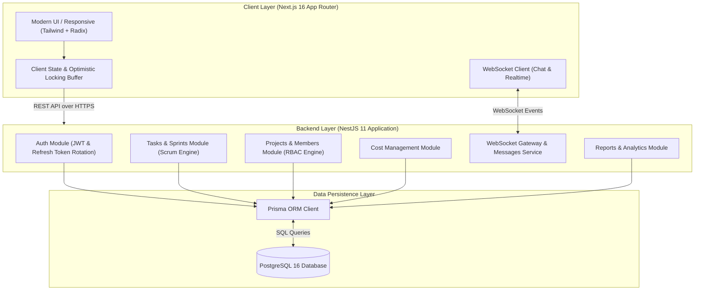
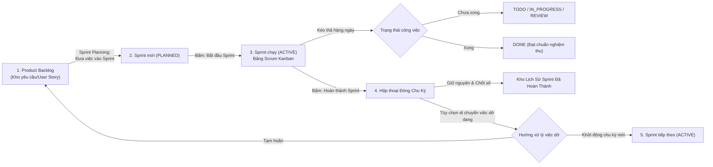

# FTodo - Nền Tảng Quản Trị Dự Án Agile Scrum & Tài Chính Toàn Diện

> **FTodo** là giải pháp phần mềm quản trị dự án công nghệ thế hệ mới, kết hợp linh hoạt giữa phương pháp luận **Agile/Scrum quốc tế** (tương đương Jira/Linear), công cụ **kiểm soát chi phí & ngân sách** (Cost Management), phân hệ **trao đổi trực tuyến thời gian thực** (Team Chat tương tự Slack) và hệ thống **báo cáo vận tốc & nghiệm thu chuyên nghiệp**.

---

## 📑 Mục Lục
1. [Tổng Quan Dự Án & Giá Trị Cốt Lõi](#1-tổng-quan-dự-án--giá-trị-cốt-lõi)
2. [Kiến Trúc Kỹ Thuật (Architecture & Tech Stack)](#2-kiến-trúc-kỹ-thuật-architecture--tech-stack)
3. [Sơ Đồ Hệ Thống & Luồng Quy Trình Scrum](#3-sơ-đồ-hệ-thống--luồng-quy-trình-scrum)
4. [Chi Tiết Các Phân Hệ Chức Năng](#4-chi-tiết-các-phân-hệ-chức-năng)
   - [4.1. Dashboard Tổng Quan Dự Án (Project Overview)](#41-dashboard-tổng-quan-dự-án-project-overview)
   - [4.2. Bảng Scrum Kanban Kéo Thả (Scrum Board)](#42-bảng-scrum-kanban-kéo-thả-scrum-board)
   - [4.3. Quản Lý Product Backlog & Chu Kỳ Sprint](#43-quản-lý-product-backlog--chu-kỳ-sprint)
   - [4.4. Quản Lý Tác Vụ & Sự Vụ (Issues Tracker)](#44-quản-lý-tác-vụ--sự-vụ-issues-tracker)
   - [4.5. Lộ Trình & Tiến Độ Trực Quan (Timeline / Gantt View)](#45-lộ-trình--tiến-độ-trực-quan-timeline--gantt-view)
   - [4.6. Quản Lý Chi Phí & Ngân Sách Dự Án (Cost Management)](#46-quản-lý-chi-phí--ngân-sách-dự-án-cost-management)
   - [4.7. Báo Cáo Nghiệm Thu & Phân Tích Vận Tốc (Reports & Velocity)](#47-báo-cáo-nghiệm-thu--phân-tích-vận-tốc-reports--velocity)
   - [4.8. Kênh Trao Đổi Đội Ngũ Thời Gian Thực (Team Chat Channels)](#48-kênh-trao-đổi-đội-ngũ-thời-gian-thực-team-chat-channels)
   - [4.9. Phân Quyền Vai Trò & Thành Viên (RBAC & Members)](#49-phân-quyền-vai-trò--thành-viên-rbac--members)
   - [4.10. Nhật Ký Hoạt Động & Kiểm Vết (Audit Trail / Activity Log)](#410-nhật-ký-hoạt-động--kiểm-vết-audit-trail--activity-log)
5. [Thiết Kế Cơ Sở Dữ Liệu (Database Schema)](#5-thiết-kế-cơ-sở-dữ-liệu-database-schema)
6. [Cơ Chế Bảo Mật & Tối Ưu Trải Nghiệm Người Dùng](#6-cơ-chế-bảo-mật--tối-ưu-trải-nghiệm-người-dùng)
7. [Hướng Dẫn Cài Đặt & Vận Hành (Getting Started)](#7-hướng-dẫn-cài-đặt--vận-hành-getting-started)

---

## 1. Tổng Quan Dự Án & Giá Trị Cốt Lõi

Trong các dự án phát triển phần mềm và công nghệ hiện nay, các doanh nghiệp thường phải sử dụng rời rạc nhiều công cụ: Jira để quản lý Task/Sprint, Excel để kiểm soát chi phí dự án, Slack để trao đổi nội bộ, và Word/PDF để làm báo cáo nghiệm thu gửi khách hàng.

**FTodo** ra đời nhằm giải quyết triệt để sự phân mảnh này bằng một nền tảng thống nhất duy nhất:
* **Chuẩn hóa Agile/Scrum:** Đầy đủ các khái niệm chuẩn Scrum: Product Backlog, Sprint Planning, Story Points, Definition of Done, Velocity Chart, Burndown, Sprint Review & Retrospective.
* **Minh bạch Tài chính:** Theo dõi sát sao từng đồng chi phí (Nhân sự, Cloud/Server, License phần mềm) theo từng dự án và từng Sprint.
* **Cộng tác Thời gian thực (Real-time Collaboration):** Bảng Scrum cập nhật tức thời không giật lag, kênh Chat nhóm phân theo chuyên đề, trạng thái Online/Offline sống động.
* **Bảo vệ Dữ liệu Lịch sử (Historical Preservation):** Khi một Sprint kết thúc, toàn bộ các thẻ công việc đã hoàn thành cùng chỉ số nghiệm thu được bảo toàn tuyệt đối để phục vụ tra cứu và kiểm toán.

---

## 2. Kiến Trúc Kỹ Thuật (Architecture & Tech Stack)

Hệ thống được xây dựng theo kiến trúc **Client - Server (Decoupled Monolith / Modular Backend)** hiện đại, đảm bảo tính mở rộng cao và độ trễ thấp.

### 2.1. Frontend Stack
* **Framework:** [Next.js 16](https://nextjs.org/) (App Router, Turbopack, React 19).
* **Styling & UI Kit:** Tailwind CSS, Radix UI, [shadcn/ui](https://ui.shadcn.com/) components.
* **Icons & Visuals:** Lucide React, Recharts (Vẽ biểu đồ Vận tốc, Burndown, Phân bổ chi phí).
* **State & Sync:** Context API (`AuthContext`, `ProjectContext`), Optimistic UI Updates, Custom Polling với bộ đệm chống xung đột (Optimistic Lock buffer).

### 2.2. Backend Stack
* **Framework:** [NestJS](https://nestjs.com/) (Kiến trúc Module, Controllers, Services, Gateways).
* **Language:** TypeScript 5.7+ (Strict Mode).
* **Bảo mật & Middleware:** Helmet, CORS, Throttler (Rate Limiting chống brute-force/DDoS), Passport JWT, Bcrypt password hashing.
* **Tài liệu API:** Swagger / OpenAPI 3.0 tự động tích hợp tại `/api/docs`.

### 2.3. Cơ sở dữ liệu & Hạ tầng
* **Database:** PostgreSQL 16 chạy trên Docker Container cô lập.
* **ORM:** [Prisma ORM 6.4](https://www.prisma.io/) với quan hệ cascade delete chặt chẽ, type-safe queries, migration tự động và seed scripts.
* **Thời gian thực:** WebSocket Gateway (Socket.io) tích hợp trong NestJS.

---

## 3. Sơ Đồ Hệ Thống & Luồng Quy Trình Scrum

### 3.1. Sơ đồ Tổng Thể Kiến Trúc (Architecture Diagram)



---

### 3.2. Sơ đồ Chu Kỳ Sprint & Quản Lý Luồng Công Việc



---

## 4. Chi Tiết Các Phân Hệ Chức Năng

### 4.1. Dashboard Tổng Quan Dự Án (Project Overview)
* **Chỉ số Sức khỏe Dự án (Project KPIs):** Hiển thị trực quan tiến độ Sprint hiện tại, tỷ lệ Story Points đã đạt, tổng ngân sách đã giải ngân và số thành viên tham gia.
* **Mục tiêu Sprint (Sprint Goal):** Ghim thông điệp cốt lõi mà đội ngũ cam kết hoàn thành trong 2 tuần.
* **Biểu đồ Vận tốc thu nhỏ & Phân bổ Công việc:** Giúp Tech Lead nắm bắt ngay phân bố công việc giữa các lập trình viên.
* **Nhật ký Hoạt động Gần đây (Recent Activity):** Cập nhật từng phút các thao tác chuyển trạng thái task hoặc phê duyệt chi phí.

---

### 4.2. Bảng Scrum Kanban Kéo Thả (Scrum Board)
* **4 Cột Trạng Thái Tiêu Chuẩn:**
  1. `TODO` (Cần làm)
  2. `IN_PROGRESS` (Đang triển khai)
  3. `REVIEW` (Kiểm thử / Đang duyệt code)
  4. `DONE` (Đã hoàn thành theo Definition of Done)
* **Bộ Chọn Sprint Đa Năng (Sprint Selector):**
  * Mặc định hiển thị Sprint đang hoạt động (`⚡ Active Sprint`).
  * Cho phép bấm chọn xem lại bất kỳ Sprint cũ nào (`✓ Sprint đã hoàn thành`). Khi xem Sprint cũ, hệ thống tự động bật **chế độ lưu trữ an toàn** để bảo vệ dữ liệu không bị kéo thả sai lệch.
* **Bộ Lọc Thông Minh (Agile Quick Filters):**
  * Nút 1-chạm **"Việc của tôi" (My Tasks)**: Lọc ngay lập tức các thẻ được phân công cho chính người dùng đang đăng nhập.
  * Lọc theo Loại việc (`User Story`, `Technical Task`, `Bug`).
  * Lọc theo Mức độ ưu tiên (`Cao`, `Trung bình`, `Thấp`).
  * Tìm kiếm tức thời theo mã công việc (ví dụ: `FT-101`) hoặc tiêu đề.
* **Cơ chế Khóa Lạc Quan & Triệt Tiêu Giật Lag (Optimistic UI & Anti-Jitter):**
  * Khi kéo thả thẻ, giao diện cập nhật ngay trong `0ms`.
  * Bộ đệm bảo vệ 6 giây (`pendingStatusUpdatesRef`) ngăn chặn triệt để hiện tượng server polling ghi đè ngược làm giật thẻ trở lại cột cũ.

---

### 4.3. Quản Lý Product Backlog & Chu Kỳ Sprint
* **Phân định Rạch Ròi giữa Active Sprint & Product Backlog:**
  * Khung Sprint đang chạy nằm ở trên cùng, chỉ chứa các công việc thuộc chu kỳ hiện tại.
  * Kho Product Backlog nằm ở dưới, chứa các công việc chưa được gán chu kỳ để đội ngũ tinh gọn kế hoạch.
* **Ước Lượng Story Points & Phân Chia Epic WBS:**
  * Gán điểm nỗ lực theo dãy Fibonacci chuẩn Scrum (1, 2, 3, 5, 8, 13 SP).
  * Gom nhóm các công việc theo Epic lớn (ví dụ: *Xác thực & Bảo mật*, *Kiến trúc Cốt lõi*, *Giao tiếp Đội ngũ*).
* **Nút "Bắt đầu Sprint" (Start Sprint) & "Hoàn thành Sprint" (Complete Sprint):**
  * Hỗ trợ đầy đủ vòng đời chu kỳ: từ `PLANNED` ➔ `ACTIVE` ➔ `COMPLETED`.
  * Hộp thoại kết thúc Sprint thông minh: Tự động tính toán số Sprint tiếp theo (`Sprint 2`, `Sprint 3`...), cho phép tự nhập tên Sprint mới tùy ý hoặc chọn kích hoạt một Sprint đã lên lịch từ trước.
* **Kho Lưu Trữ Lịch Sử Sprint Đã Hoàn Thành (Completed Sprints Archive):**
  * Đặt ngay dưới trang Backlog với danh thiếp từng Sprint quá khứ, ghi rõ ngày bắt đầu - ngày kết thúc, số điểm SP đạt được, tỷ lệ hoàn thành.
  * Có nút thu gọn/mở rộng để duyệt lại chi tiết từng Task đã nghiệm thu.

---

### 4.4. Quản Lý Tác Vụ & Sự Vụ (Issues Tracker)
* Giao diện dạng bảng danh sách (Table View) tối ưu cho Quản trị viên và Tester/QA.
* Ghi nhận tức thời mọi lỗi phát sinh (Bug) hoặc ý tưởng tính năng mà chưa cần biết sẽ xếp vào Sprint nào.
* Thống nhất thuật ngữ đồng bộ trên toàn hệ thống (*"Tạo công việc mới - Create Issue"*), tránh gây nhầm lẫn giữa tác vụ và công việc.

---

### 4.5. Lộ Trình & Tiến Độ Trực Quan (Timeline / Gantt View)
* Biểu diễn tiến độ toàn diện của dự án theo trục thời gian tuyến tính (Gantt Chart).
* Chuyển đổi linh hoạt giữa chế độ xem theo **Chu kỳ Sprint** và xem theo từng **Công việc chi tiết**.
* Hiển thị tỷ lệ hoàn thành lộ trình (%), vạch chỉ báo mốc thời gian hiện tại (Today Marker) và thời hạn bàn giao (Deadlines).

---

### 4.6. Quản Lý Chi Phí & Ngân Sách Dự Án (Cost Management)
* **Kiểm Soát 3 Trụ Cột Tài Chính:** Tổng ngân sách được duyệt, Số tiền đã giải ngân (`PAID`), và Số tiền đang chờ thanh toán (`PENDING`).
* **Phân Loại Chi Phí Chuẩn:**
  * `Nhân sự` (Personnel - Lương/Thưởng Dev, QA, PM)
  * `Cơ sở hạ tầng` (Cloud AWS/GCP, Server Hosting, Tên miền)
  * `Bản quyền phần mềm` (Software Licenses, API Keys)
  * `Phần cứng & Thiết bị` (Hardware)
  * `Chi phí khác` (Other)
* **Quy Trình Phê Duyệt Chi Tiêu:** Thành viên có thể gửi đề xuất thanh toán kèm lý do; Quản trị viên hoặc Project Owner trực tiếp duyệt (`APPROVED`) hoặc từ chối (`REJECTED`).

---

### 4.7. Báo Cáo Nghiệm Thu & Phân Tích Vận Tốc (Reports & Velocity)
* **Biểu Đồ Vận Tốc (Velocity Chart):** So sánh trực quan giữa điểm cam kết (Committed Points) và điểm hoàn thành thực tế (Completed Points) qua từng Sprint, giúp đội ngũ cải thiện độ chính xác khi ước lượng.
* **Biểu Đồ Đốt Cháy (Burndown Chart):** Thể hiện tốc độ tiêu hao công việc theo từng ngày của Sprint đang chạy so với đường lý tưởng (Ideal Line).
* **Trình Tạo Báo Cáo Nghiệm Thu (Sprint Acceptance Report Generator):**
  * Tự động tổng hợp danh sách các Story/Task đã hoàn thành, các trở ngại kỹ thuật còn tồn đọng, mức độ hài lòng của đội ngũ.
  * Cho phép xuất báo cáo chuyên nghiệp định dạng in ấn / PDF để gửi Ban Giám đốc hoặc Khách hàng.

---

### 4.8. Kênh Trao Đổi Đội Ngũ Thời Gian Thực (Team Chat Channels)
* Phân chia theo kênh chuyên đề linh hoạt: `#chung`, `#phat-trien`, `#thong-bao` hoặc tạo kênh thảo luận riêng theo từng Sprint.
* Hỗ trợ nhắn tin thời gian thực, phản hồi cảm xúc (Reactions), đính kèm tài liệu, ảnh chụp màn hình lỗi.
* Chỉ báo trạng thái trực tuyến (**Online/Offline Presence**) sống động: chấm xanh hiển thị đúng khi thành viên thực sự đang mở ứng dụng.

---

### 4.9. Phân Quyền Vai Trò & Thành Viên (RBAC & Members)
* **Ma trận Phân quyền theo Nhóm (Role Groups):**
  * Khởi tạo các vai trò tùy chỉnh: `Admin`, `Product Owner`, `Scrum Master`, `DEV`, `QA`, `Viewer`.
  * Cấp quyền chi tiết theo từng phân hệ: `overview`, `board`, `backlog`, `members`, `chat`, `cost`, `reports`, `timeline`, `settings`.
* **Mời Thành Viên qua Email:** Gửi thư mời tham gia dự án kèm vai trò được định sẵn; người nhận có thể chấp thuận hoặc từ chối trên hệ thống.

---

### 4.10. Nhật Ký Hoạt Động & Kiểm Vết (Audit Trail / Activity Log)
* Ghi nhận tự động và vĩnh viễn mọi hành vi thay đổi trên dự án: ai đã tạo task, ai đã kéo thẻ sang `DONE`, ai đã phê duyệt chi phí, khi nào kết thúc Sprint.
* Đảm bảo tính minh bạch, hỗ trợ đắc lực cho các buổi họp **Sprint Retrospective (Cải tiến quy trình)**.

---

## 5. Thiết Kế Cơ Sở Dữ Liệu (Database Schema)

Cơ sở dữ liệu PostgreSQL của FTodo gồm 13 bảng quan hệ chặt chẽ:

| Tên Bảng | Vai Trò & Mô Tả |
| :--- | :--- |
| **`User`** | Lưu thông tin người dùng, mật khẩu hash Bcrypt, avatar, vai trò hệ thống, Refresh Token hash. |
| **`Project`** | Đại diện cho dự án Scrum, chứa ngân sách tổng, mô tả, liên kết với chủ dự án (`ownerId`). |
| **`RoleGroup`** | Định nghĩa các nhóm vai trò và mảng quyền hạn phân hệ (`permissions: String[]`). |
| **`ProjectMember`** | Bảng liên kết Người dùng - Dự án, gán nhóm vai trò và quyền hạn bổ sung riêng lẻ. |
| **`Sprint`** | Chu kỳ Sprint: tên, mục tiêu (`goal`), ngân sách Sprint, ngày bắt đầu/kết thúc, trạng thái (`PLANNED`, `ACTIVE`, `COMPLETED`). |
| **`Task`** | Thực thể cốt lõi cho mọi User Story, Task kỹ thuật, Bug: mã (`code`), Story Points, mức ưu tiên, trạng thái cột, người làm, Sprint gán. |
| **`Cost`** | Ghi nhận chi tiêu: số tiền, danh mục, trạng thái duyệt (`PENDING`, `APPROVED`, `PAID`), liên kết với Sprint và người đề xuất. |
| **`Channel`** | Kênh chat trao đổi nội bộ thuộc dự án (`#chung`, `#phat-trien`...). |
| **`ChannelMember`** | Quản lý thành viên tham gia từng kênh chat. |
| **`Message`** | Nội dung tin nhắn chat, tệp đính kèm (`attachment`), phản hồi cảm xúc JSON. |
| **`Report`** | Báo cáo tiến độ và nghiệm thu định kỳ gửi cấp quản lý, lưu lời nhắn, task hoàn thành, trở ngại. |
| **`ActivityLog`** | Nhật ký kiểm vết (Audit trail): ghi nhận hành động, danh mục, thời gian thực thi. |
| **`ProjectInvitation`**| Lời mời tham gia dự án gửi tới email thành viên mới kèm trạng thái chờ duyệt. |

---

## 6. Cơ Chế Bảo Mật & Tối Ưu Trải Nghiệm Người Dùng

1. **Bảo Mật Xác Thực Kép (JWT + Token Rotation):**
   * Access Token có thời hạn ngắn (15 phút) lưu trong bộ nhớ.
   * Refresh Token được mã hóa hash một chiều và lưu trong cơ sở dữ liệu, tự động cấp mới cặp token mỗi khi phiên làm việc hết hạn (Token Rotation), vô hiệu hóa ngay nếu phát hiện rò rỉ.
2. **Kiểm Soát Quyền Truy Cập Đầu Cuối (RBAC Guards):** Mọi API endpoint tại backend đều được bảo vệ bởi `JwtAuthGuard` và kiểm tra quyền của thành viên trong dự án.
3. **Phòng Chống Tấn Công Mạng:** Tích hợp `Helmet` (bảo vệ HTTP Headers) và `@nestjs/throttler` (giới hạn tần suất gọi API từ một IP).
4. **Phòng Ngừa Lỗi Mạng & Trải Nghiệm Mượt Mà:** Sử dụng cơ chế cập nhật giao diện lạc quan (Optimistic Updates) có đồng bộ xác nhận, giúp mọi thao tác kéo thả và chuyển trang tức thì mà không cần chờ đợi server phản hồi.

---

## 7. Hướng Dẫn Cài Đặt & Vận Hành (Getting Started)

### 7.1. Yêu Cầu Môi Trường
* **Node.js:** Phiên bản 18.x hoặc 20.x trở lên.
* **Docker & Docker Compose:** Dùng để chạy container PostgreSQL.
* **NPM / PNPM / Yarn.**

### 7.2. Các Bước Khởi Chạy Nhanh

#### Bước 1: Khởi động Cơ sở dữ liệu PostgreSQL
```bash
# Tại thư mục gốc dự án FTodo
docker-compose up -d
```
*Container PostgreSQL `ftodo_postgres` sẽ tự động chạy tại cổng `5433`.*

#### Bước 2: Cấu hình và Chạy Backend (NestJS)
```bash
cd backend

# Cài đặt thư viện
npm install

# Áp dụng Migration cơ sở dữ liệu
npx prisma generate
npx prisma db push

# Khởi chạy server ở chế độ phát triển (Cổng 4000)
npm run start:dev
```
* API Server: `http://localhost:4000/api`
* Swagger UI Docs: `http://localhost:4000/api/docs`

#### Bước 3: Cấu hình và Chạy Frontend (Next.js)
```bash
cd ../frontend

# Cài đặt thư viện
npm install

# Khởi chạy frontend ở chế độ phát triển (Cổng 3000)
npm run dev
```
* Ứng dụng Web: `http://localhost:3000`

---

### 7.3. Tài Khoản Thử Nghiệm Có Sẵn (Demo Credentials)

Sau khi khởi chạy, bạn có thể đăng nhập bằng các tài khoản sau với mật khẩu chung là: **`password123`**

| Email Đăng Nhập | Họ Tên Thành Viên | Vai Trò trong Dự Án FTodo |
| :--- | :--- | :--- |
| **`chien@example.com`** | Trịnh Quyết Chiến | **Project Owner / Admin** (Toàn quyền quản trị) |
| **`an@example.com`** | Nguyễn Văn An | **Senior Developer** (Phụ trách Backend & Bảng Scrum) |
| **`binh@example.com`** | Trần Thị Bình | **Senior QA / Tester** (Phụ trách Kiểm thử & Báo lỗi) |
| **`dung@example.com`** | Lê Hoàng Dũng | **Frontend Developer** (Phụ trách Giao diện & Kênh Chat) |

---

## 8. Lời Kết & Định Hướng Phát Triển

Dự án **FTodo** là minh chứng cho một giải pháp quản trị công nghệ hoàn chỉnh, kết hợp hài hòa giữa tính kỷ luật chặt chẽ của Scrum với sự linh hoạt, thân thiện của giao diện người dùng hiện đại.

Trong các phiên bản tiếp theo, dự án hướng tới tích hợp:
* **AI Copilot Scrum Master:** Tự động dự đoán rủi ro trễ tiến độ Sprint và đề xuất phân bổ Story Points tối ưu dựa trên năng suất lịch sử của team.
* **Tích Hợp Git Webhook (GitHub/GitLab):** Tự động chuyển trạng thái thẻ sang `IN_PROGRESS` khi có branch mới và sang `DONE` khi Pull Request được merge.
* **Thông Báo Đẩy Đa Kênh (Push Notifications & Telegram/Slack Bot).**

---
*Bản quyền phát triển thuộc về Đội ngũ Kỹ sư Dự án FTodo © 2026.*
